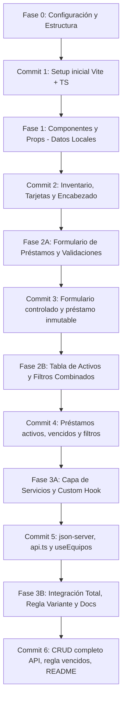

# Análisis y Plan de Trabajo: Sistema de Préstamos de Equipos

**Estudiante:** Carné terminado en **7**  
**Variante Asignada:**
- **Categorías válidas:** `Monitor`, `Teclado`, `Mouse`
- **Plazo máximo de préstamo:** `5 días`
- **Regla adicional:** Mostrar en el `Encabezado` cuántos préstamos están **vencidos** (además del contador de disponibles).
- **Título obligatorio:** `"Préstamos Lab — <su carné>"` (en el Encabezado y en la pestaña del navegador `<title>`).

---

## 1. Análisis sobre el uso de Docker

### ¿Se puede usar Docker?
**Sí, técnicamente es posible**, pero para los objetivos específicos de esta tarea académica **NO es recomendable como entorno principal de entrega**.

### Motivos:
1. **Requisitos de la rúbrica / profesor:**
   - La guía especifica explícitamente:  
     `npm create vite@latest -- --template react-ts` y un `README.md con los pasos para instalar dependencias, levantar la API y ejecutar el frontend`.
   - Si el profesor o auxiliar clona el repositorio y evalúa mediante `npm install` y `npm run dev`, una dependencia obligatoria de Docker puede complicar la revisión si no tienen Docker Desktop activo.
2. **Complejidad innecesaria vs. simplicidad de `json-server`:**
   - Con `json-server` basta con un simple script en `package.json` (`npm run server` o usando `concurrently` para correr API + Frontend con un solo `npm run dev`).
   - El setup con Node.js es inmediato (menos de 2 segundos de arranque), sin consumo excesivo de RAM ni problemas de sincronización de volúmenes en Windows.
3. **Decisión sugerida:**
   - Trabajar el proyecto directamente con **Node.js + npm** (100% nativo y estándar para Vite + TypeScript).
   - *Opcional:* Si deseas tener Docker por aprendizaje personal, podemos dejar un `docker-compose.yml` secundario al final, pero asegurando que el flujo nativo de `npm` sea el método principal documentado en el `README.md`.

---

## 2. Desglose de Requisitos y Restricciones Técnicas

### 2.1 Restricciones estrictas
- **Cero librerías externas de estado:** Prohibido Redux, Zustand, Context complejo si busca emular store global. Únicamente hooks nativos (`useState`, `useEffect`, Custom Hooks).
- **Cero librerías de formularios:** Prohibido Formik, React Hook Form. Todos los formularios deben ser controlados (`value` + `onChange`) con validación manual.
- **Tipado TypeScript estricto:** Prohibido el uso de `any`. Interfaces claras para props y modelos.
- **Inmutabilidad estricta:** Todas las actualizaciones de estado deben usar funciones inmutables (`map`, `filter`, spread `[...]`, `{...}`). Prohibido `push`, `splice` o mutación directa.

### 2.2 Modelos de Datos

```typescript
export interface Equipo {
  id: number;
  nombre: string;
  categoria: 'Monitor' | 'Teclado' | 'Mouse'; // Restringido a la variante 7
  disponible: boolean;
}

export interface Prestamo {
  id: number;
  equipoId: number;
  solicitante: string;
  carne: string; // Formato 0000-00-00000
  fechaPrestamo: string; // ISO 8601
  fechaLimite: string; // ISO 8601 (máximo 5 días desde hoy)
  devuelto: boolean;
}
```

---

## 3. Plan de Trabajo Fase por Fase

El trabajo se dividirá en 4 fases, sincronizadas con los **6 commits mínimos requeridos para GitHub**.



---

### Fase 0: Inicialización y Estructura Base
- Crear proyecto con Vite: `npm create vite@latest . -- --template react-ts`.
- Definir sistema de estilos (Recomendación: CSS Modules o Tailwind CSS para velocidad y diseño limpio).
- Organizar estructura de directorios:
  ```text
  src/
    components/
      Encabezado/
      Inventario/
        TarjetaEquipo/
        ListaEquipos/
        FiltrosInventario/
      Prestamos/
        FormularioPrestamo/
        TablaPrestamos/
      UI/ (Modal, EstadoCarga, MensajeError)
    hooks/
      useEquipos.ts
    services/
      api.ts
    types/
      equipo.ts
      prestamo.ts
    data/
      db.json (para json-server)
      equiposIniciales.ts (para Fase 1)
    App.tsx
    main.tsx
  ```
- **Hito Git:** `Commit 1: Estructura inicial del proyecto con Vite y TypeScript`.

---

### Fase 1: Componentes, Props y Tipado (Datos Locales)
- Crear `Encabezado`:
  - Título: `"Préstamos Lab — <su carné>"`.
  - Contador derivado: `"X de Y equipos disponibles"`.
  - Actualizar el título de la pestaña del navegador (`document.title`).
- Crear mock local con **al menos 8 equipos** repartidos únicamente entre: `Monitor`, `Teclado`, `Mouse`.
- Crear `TarjetaEquipo`:
  - Props tipadas con `TarjetaEquipoProps` (sin `any`).
  - Badge visual verde ("Disponible") o rojo ("Prestado").
  - Botón "Prestar" (deshabilitado si `!disponible`).
- Crear `ListaEquipos`:
  - Renderizado con `.map()` usando `equipo.id` como `key`.
- **Hito Git:** `Commit 2: Vista de Inventario con componentes funcionales y datos locales`.

---

### Fase 2: Estado Local, Formularios y Eventos
- **Fase 2A: Formulario y Registro de Préstamo**
  - Estados en el componente principal: `equipos` y `prestamos`.
  - Modal/Panel `FormularioPrestamo`:
    - Campos controlados: `solicitante`, `carne`, `fechaLimite`.
    - Validaciones:
      1. Solicitante: obligatorio, mínimo 5 caracteres.
      2. Carné: Regex `^\d{4}-\d{2}-\d{5}$`.
      3. Fecha límite: no anterior a hoy y **máximo 5 días desde hoy** (variante 7).
    - Mensajes de error específicos debajo de cada input.
    - Al guardar: agregar préstamo y cambiar estado del equipo a `disponible: false` de forma inmutable.
  - **Hito Git:** `Commit 3: Formulario controlado de préstamos con validaciones por variante`.

- **Fase 2B: Préstamos Activos y Filtros**
  - Componente `TablaPrestamos` (solo préstamos activos / no devueltos):
    - Columnas: Equipo, Solicitante, Carné, Fecha Límite, Acciones.
    - Resaltado visual (ej. fondo rojo suave / badge de advertencia) para préstamos cuya `fechaLimite < hoy`.
    - Botón "Devolver": marca `devuelto: true` y restaura el equipo a `disponible: true` inmutablemente.
  - Filtros combinados en Inventario:
    - `select` por categoría (`Todos`, `Monitor`, `Teclado`, `Mouse`).
    - `input` de búsqueda por texto (filtra por nombre).
    - Estado derivado: `equiposFiltrados` (sin duplicar estado).
  - **Hito Git:** `Commit 4: Tabla de préstamos con alerta de vencimiento y filtros combinados`.

---

### Fase 3: Persistencia con API REST y Custom Hook
- Configuración de `json-server` con archivo `db.json` y scripts en `package.json`.
- Variable de entorno `.env`: `VITE_API_URL=http://localhost:3001`.
- Crear `src/services/api.ts`:
  - `obtenerEquipos(): Promise<Equipo[]>`
  - `obtenerPrestamosActivos(): Promise<Prestamo[]>`
  - `crearPrestamo(prestamo: Omit<Prestamo, 'id'>): Promise<Prestamo>`
  - `actualizarDisponibilidadEquipo(id: number, disponible: boolean): Promise<Equipo>`
  - `marcarPrestamoDevuelto(id: number): Promise<Prestamo>`
- Custom Hook `useEquipos()`:
  - Manejo de `data`, `loading`, `error` y función `recargar()`.
- Vista Inventario con estados de:
  - Carga (Spinner / skeleton).
  - Error (Mensaje claro con botón **Reintentar**).
- Manejo de concurrencia: Deshabilitar botón de envío mientras se realiza la petición HTTP para evitar dobles registros.
- **Hito Git:** `Commit 5: Integración de API REST, servicio api.ts y custom hook useEquipos`.

---

### Fase 4: Regla Adicional de la Variante, Documentación y Entregables
- **Implementación de la Regla de la Variante 7:**
  - Contador en el `Encabezado`: Calcular cuántos préstamos activos tienen `fechaLimite < fechaActual` y mostrar:
    `"X de Y equipos disponibles | Z préstamos vencidos"`.
- **Hito Git:** `Commit 6: Regla de variante 7, README detallado y ajustes finales`.

---

## 4. Guía de Respuestas a las Preguntas de Reflexión (Para el PDF)

| Pregunta | Concepto Clave a Desarrollar (Máx. 5 líneas) |
| :--- | :--- |
| **Parte 1:** ¿Por qué no conviene usar el índice como key si la lista cambia? | React utiliza la `key` para el algoritmo de reconciliación (Virtual DOM diffing). Si los elementos se filtran, reordenan o eliminan, los índices cambian de posición, provocando que React asocie estados internos o inputs no controlados al elemento incorrecto, degradando el rendimiento y causando bugs visuales. |
| **Parte 2:** ¿Qué problema aparece si se modifica directamente el arreglo del estado? | React detecta cambios mediante comparación superficial de referencias (`prevProps !== nextProps` o `Object.is`). Al mutar directamente el arreglo original con métodos como `push`, la referencia en memoria sigue siendo la misma, por lo que React no detecta el cambio y no dispara el re-renderizado de la interfaz. |
| **Parte 3:** ¿Qué ocurre si omite el arreglo de dependencias en un useEffect con fetch y setState? | Al omitir el arreglo de dependencias, `useEffect` se ejecuta después de **cada renderizado**. Como el fetch actualiza el estado al recibir la respuesta, este cambio de estado provoca un nuevo renderizado, ejecutando nuevamente el efecto y cayendo en un **bucle infinito** de peticiones que saturará la API y el navegador. |

---

## 5. Checklist de Capturas Obligatorias para el PDF
- [ ] 1. Vista general del **Inventario** con tarjetas y badges de estado.
- [ ] 2. **Formulario de préstamo** abierto mostrando los mensajes de error de validación (solicitante corto, carné con formato inválido, fecha fuera de rango).
- [ ] 3. Vista de **Préstamos Activos** con al menos una fila resaltada como **vencida**.
- [ ] 4. Estado de **Error de la API** en pantalla con el botón **Reintentar** visible (simulando API apagada).
- [ ] 5. Encabezado mostrando el contador de equipos disponibles y el contador de préstamos vencidos (regla variante 7).
